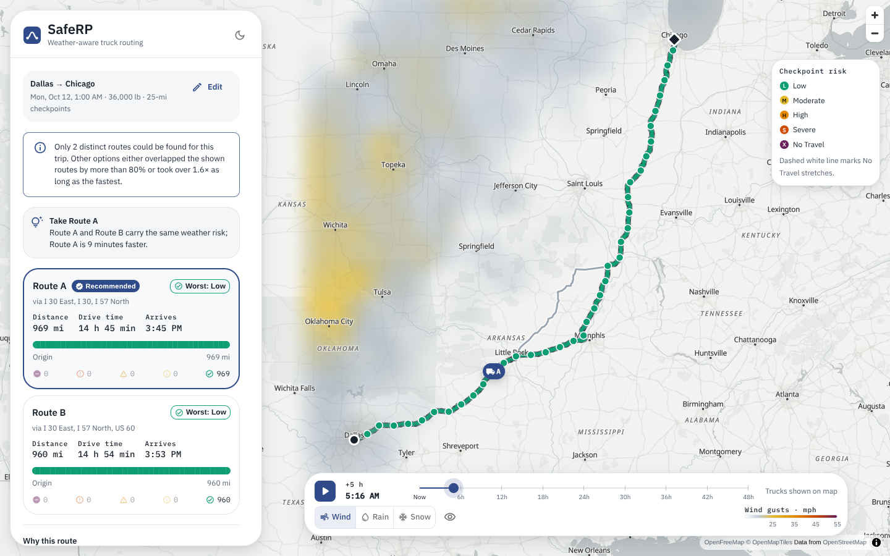
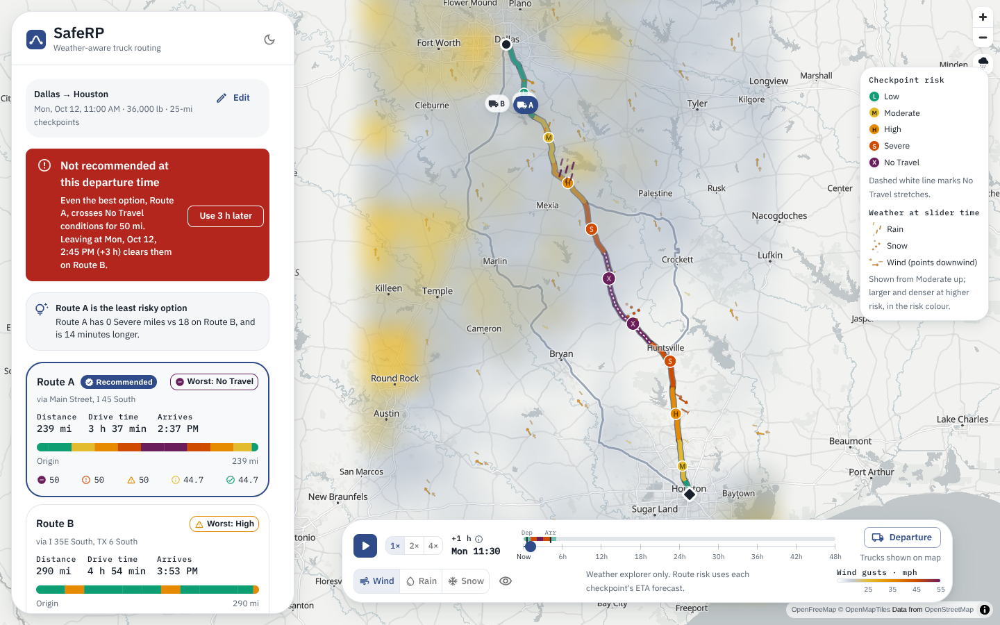
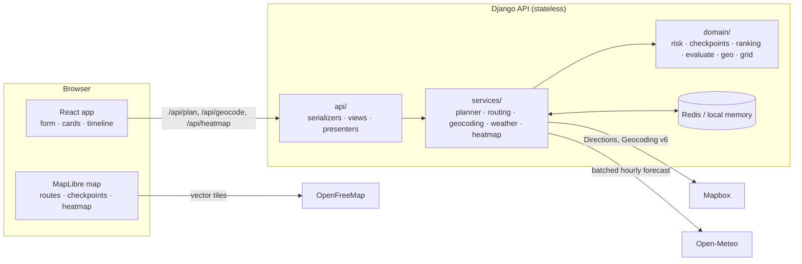

# SafeRP — weather-aware truck route planner

A truck driver enters an origin, destination, departure time and load weight. SafeRP finds up to
three route options, places checkpoints along each, forecasts the weather at the moment the truck
reaches each checkpoint, scores every stretch of road against fixed risk rules, and recommends a
route with a plain-language reason. A map shows the routes, per-segment risk and a 0–48 h weather
heatmap with a time slider and moving truck markers.

## Screenshots





*Second image: forecast slider at the departure hour, with the hazard timeline above the track
and animated rain, snow and wind along Route A and across the corridor. The weather was calm on
the day of capture, so the risk levels and hazards in this image were injected into the API
responses for illustration.*

## Features

- **Three route options** for a truck of the given weight, with checkpoints every 10, 25 or 50 mi.
- **Risk at the moment the truck arrives:** each checkpoint is scored on the forecast for its ETA,
  then routes are ranked and one is recommended with a plain-language reason. If the trip is
  unsafe, the nearest later departure that is safe is suggested.
- **Route cards and risk strip:** miles per risk level and a start-to-finish strip linked to
  the map (hover, arrow keys, Enter for details).
- **Forecast slider (0–48 h):**
  - The label shows "Tue 14:00 · +N h".
  - Play/pause at 1×, 2× or 4×; arrow keys and Home/End work.
  - A **Departure** button, departure and arrival markers on the track, and a thin **hazard
    timeline** colouring each hour by the worst risk the truck meets on the selected route.
  - Truck markers show where each truck would be at the slider time.
  - Scrubbing never makes a network request. The slider explores the weather; it never changes
    risk or the recommendation.
- **Corridor heatmap** for wind, rain or snow, coloured at the risk thresholds.
- **Weather animations:**
  - Falling rain streaks, drifting snow, and wind streaks pointing downwind appear wherever the
    forecast at the slider hour reaches Moderate or worse, both along the routes and across the
    corridor.
  - They are drawn in the risk colours and grow with the level.
  - They are rendered by MapLibre as animated icons (capped at 24 fps, paused when hidden),
    respect reduced motion, and can be switched off with the map button (remembered).

- **Backend:** Django 5.2 + Django REST Framework, stateless, Redis or in-memory cache
- **Frontend:** React 19 + TypeScript + Vite, Material UI 9, MapLibre GL via react-map-gl, TanStack Query
- **Data:** Mapbox Directions and Geocoding (routing, place search), Open-Meteo (forecasts), OpenFreeMap (base map)

## Architecture



**One plan request, step by step** ([`services/planner.py`](backend/core/services/planner.py)):

1. **Routes.** One Mapbox request with `alternatives=true` and the truck's `max_weight`. If fewer
   than 3 distinct routes come back, `exclude=motorway`, `exclude=toll` and two perpendicular
   via-points are requested in parallel. Candidates sharing more than 80% of their length with a
   chosen route, or taking more than 1.6× the fastest time, are dropped.
2. **Checkpoints.** Every 10/25/50 miles plus origin and destination. ETAs are interpolated from
   Mapbox's per-segment duration annotations (not a constant speed), scaled by `TRUCK_SPEED_FACTOR`.
3. **Forecasts.** All checkpoint coordinates (rounded to 2 decimals) are fetched in batches of 100
   from Open-Meteo, in parallel, with each point's 7-day hourly series cached for 30 minutes.
4. **Risk.** Each checkpoint reads the hourly bucket that contains its ETA and is classified by the
   rules below. It owns the road from the midpoint with its previous checkpoint to the midpoint
   with its next one, and those miles are summed per level.
5. **Ranking.** Lexicographic, lower is better: No Travel miles → Severe → High → average risk →
   travel time, rounded before comparing. If the winner still has No Travel miles, later departures
   (+1…+12 h) are re-evaluated against the forecasts already in hand, and the first that clears
   them is suggested.

The **domain layer** ([`backend/core/domain/`](backend/core/domain/)) is pure Python with no I/O
and no Django imports, and a test enforces that.

## Risk rules

Implemented in [`backend/core/domain/risk.py`](backend/core/domain/risk.py). Ranges are half-open,
so every decimal has exactly one level.

| Level | Wind (mph) | Rain (in/h) | Snow (in/h) |
| --- | --- | --- | --- |
| Low (0) | < 25 | < 0.10 | < 0.5 |
| Moderate (1) | 25 – < 35 | 0.10 – < 0.25 | 0.5 – < 1.0 |
| High (2) | 35 – < 45 | 0.25 – < 0.50 | 1.0 – < 2.0 |
| Severe (3) | 45 – < 55 | 0.50 – 1.00 | 2.0 – 3.0 |
| No Travel (4) | **≥ 55** | **> 1.00** | **> 3.0** |

Load rules, applied to the wind level: wind ≥ 55 → No Travel for any load; 45–55 mph with load
> 30,000 lb → No Travel; 35–45 mph with load > 40,000 lb → Severe. Checkpoint level =
max(wind after load rules, rain, snow), and the factor(s) responsible are reported. Wind means
**gusts** by default (`WIND_METRIC=gust`). Both gusts and sustained speed are shown in the UI.

## Running locally

Prerequisites: Python 3.12 with [uv](https://docs.astral.sh/uv/), Node 20+, and a Mapbox access
token (default public scopes are enough).

```bash
# Backend: http://127.0.0.1:8000
cd backend
cp .env.example .env            # set MAPBOX_ACCESS_TOKEN
uv sync
uv run python manage.py runserver 8000

# Frontend: http://localhost:5173 (proxies /api to :8000)
cd frontend
npm install
npm run dev
```

If upstream calls stall for ~15 seconds on your network (a broken IPv6 DNS resolver), set
`HTTP_FORCE_IPV4=true` in `backend/.env`.

### Tests and linters

```bash
cd backend  && uv run pytest && uv run ruff check . && uv run ruff format --check .
cd frontend && npm test && npm run lint && npm run typecheck && npm run format:check
```

- **Backend:** 143 pytest cases. They include every threshold edge
  (24.9/25/34.9/35/44.9/45/54.9/55; 0.09/0.10/0.25/0.50/1.00/1.01; 0.49/0.5/1.0/2.0/3.0/3.01), every
  load rule at 30,000/30,001/40,000/40,001 lb, mile attribution, ETA interpolation, ranking
  including ties, and API tests against recorded Mapbox/Open-Meteo responses
  (`tests/fixtures`, re-recordable with `uv run python scripts/record_fixtures.py`), plus the hourly
  hazard levels behind the animations.
- **Frontend:** 59 Vitest cases. They cover formatting, geometry, form validation, route cards, the
  risk strip's keyboard model, the results panel and the No Travel banner. They also cover the
  slider: truck position at an hour, the worst-level hazard timeline, departure jump, speeds, and
  keyboard. And the animations: dominant hazard, the Moderate-or-higher filter, wind rotation,
  and the frame-capped, pausable animation clock.

## Configuration

Backend (`backend/.env`, or platform environment variables):

| Variable | Default | Purpose |
| --- | --- | --- |
| `MAPBOX_ACCESS_TOKEN` | — (required) | Directions + Geocoding, server-side only |
| `DJANGO_SECRET_KEY` | dev value | Set a long random value in production |
| `DJANGO_DEBUG` | `false` | |
| `DJANGO_ALLOWED_HOSTS` | `localhost,127.0.0.1,.vercel.app` | Comma-separated |
| `CORS_ALLOWED_ORIGINS` | `http://localhost:5173,…` | Frontend origin(s) |
| `CORS_ALLOWED_ORIGIN_REGEXES` | — | e.g. preview deployments |
| `REDIS_URL` (or `KV_URL`) | — | Shared cache; local memory when unset |
| `WIND_METRIC` | `gust` | `gust` or `sustained` |
| `TRUCK_SPEED_FACTOR` | `1.0` | 0.9 = truck 10% slower than Mapbox's estimate |
| `FORECAST_HORIZON_HOURS` | `168` | Forecast fetched per point; trips must end inside it |
| `MAX_WEATHER_POINTS` | `500` | Per-plan cap on forecast locations |
| `HEATMAP_MAX_POINTS` | `400` | Grid size cap |
| `GEOCODE_COUNTRY` | `us` | Place-search country filter (empty = worldwide) |
| `THROTTLE_PLAN` / `THROTTLE_HEATMAP` / `THROTTLE_GEOCODE` | `12/min` / `12/min` / `120/min` | Per-IP limits |
| `HTTP_FORCE_IPV4` | `false` | Work around broken IPv6 DNS |

Frontend: `VITE_API_BASE_URL`, the API origin. Leave it empty locally, where Vite proxies `/api`.

## API

All errors use one shape, `{"error": {"code": "...", "message": "human readable"}}`: 400 invalid
input, 422 valid but unplannable, 429 throttled, and 502 when an upstream service fails (the message
names the service; never a stack trace). Responses are gzip-compressed.

| Endpoint | Description |
| --- | --- |
| `GET /api/health` | Liveness and whether a Mapbox token is configured |
| `GET /api/geocode?q=dal&proximity=lon,lat` | Place autocomplete (`results[]`: id, name, label, lon, lat) |
| `POST /api/plan` | Routes, checkpoints, summaries and recommendation (below) |
| `GET /api/heatmap?bbox=minLon,minLat,maxLon,maxLat` | Corridor grid: `points` once, then per hour (49 frames) `wind`/`rain`/`snow` values, `levels.{wind,rain,snow}` (one level digit per point) and `windDir` |

```jsonc
// POST /api/plan
{
  "origin": { "lon": -96.80, "lat": 32.78, "label": "Dallas, Texas" },
  "destination": { "lon": -95.37, "lat": 29.76, "label": "Houston, Texas" },
  "departure": "2026-10-12T15:00:00Z",
  "weightLb": 36000,          // 1,000–80,000
  "intervalMi": 25            // 10 | 25 | 50
}
// → { routes: [{ id, name, via, rank, distanceMi, durationS, departure, arrival,
//               geometry, cumDurationS, segments[], checkpoints[], summary,
//               hourly: { wind[], rain[], snow[], windDir[] } }],
//     recommendation: { routeId, reason, notRecommended, suggestion, ranking[] },
//     notices: [], meta: { windMetric, intervalMi, weightLb, departure, bbox,
//                          hourlyAnchor, hourlyHours } }
```

Each checkpoint carries its ETA, sustained wind, gusts, direction, rain, snow, temperature, level,
per-factor levels, the factor(s) that drove the level and any load rule that fired.

`routes[].hourly` feeds the slider's animations only. Each entry is one string per slider hour
with one level digit per checkpoint (e.g. `"0012"`), from the risk-table thresholds without load
rules, plus wind direction in degrees. It never affects risk or ranking.

## Why these APIs

- **Mapbox Directions** gives up to two alternatives, per-segment `duration`/`distance` annotations
  for realistic ETAs, and a `max_weight` restriction, all in one call. **Geocoding v6** shares the
  same token and supports autocomplete.
- **Open-Meteo** needs no key, has hourly gusts and separates rain, showers and snowfall in inches,
  and takes many coordinates per request, which keeps a whole route to one or a few calls.
- **OpenFreeMap** vector styles (`positron`, `dark`) are free and keyless, with matching light and
  dark designs. Both style URLs were checked before use.
- The heatmap is built from the same Open-Meteo data on a backend grid rather than third-party
  weather tiles, so its colours line up with the risk thresholds and no extra provider is involved.

## Assumptions

- US trucking: imperial units, a US place-search filter, and the 80,000 lb federal gross limit as
  the upper bound. Routing itself works wherever Mapbox does.
- Mapbox's driving profile with `max_weight` approximates truck routing. Height, length, hazmat
  and other truck restrictions are not modelled.
- The forecast is treated as truth for the hour bucket containing each ETA. Precipitation and gusts
  are preceding-hour values; sustained wind uses the nearest hour.
- Times are UTC end to end; the browser shows local time.

Every judgment call is recorded in [DECISIONS.md](DECISIONS.md).

## Limitations

- Mapbox's car-based durations ignore truck speed limits, rest breaks and hours-of-service rules.
  `TRUCK_SPEED_FACTOR` is a single global correction.
- Weather between checkpoints is not sampled: a 25-mile interval can miss a narrow squall line.
  Choose 10 miles for finer coverage.
- Rounding forecast lookups to 2 decimals (~1 km) is finer than the forecast models' own resolution
  (~3–11 km), so neighbouring checkpoints can share a model cell.
- Forecasts extend 7 days. A trip must end within that, and the later-departure search stops at
  +12 h or the end of the fetched forecast, whichever comes first.
- Open-Meteo's free tier (600 calls/min, weighted per location) limits throughput. Caching absorbs
  repeat plans, but a burst of distinct long trips at a 10-mile interval can hit the limit, which
  surfaces as a clear 502.
- The progress indicator's stages are timed estimates; the plan is a single request.

## Project layout

```
backend/
  saferp/             settings (env-driven), urls, wsgi
  core/domain/        pure logic: risk, weather sampling, geo, checkpoints, ranking, evaluate, routes, grid
  core/services/      I/O: http (pooled session + retry), cache, routing, geocoding, weather, heatmap, planner
  core/api/           serializers, presenters (camelCase JSON), views, error handler
  tests/              pytest suites + recorded fixtures
frontend/
  src/api/            typed client + TanStack Query hooks
  src/components/     panel, form, cards, risk strip, banners, timeline, legend
  src/map/            MapView (lazy chunk), layer styles, markers, popup
  src/state/          zustand stores (trip form, UI selection/hover/timeline)
  src/theme/          MUI theme, risk palette and icons
```

See [DEPLOY.md](DEPLOY.md) for deployment and [LOOM_SCRIPT.md](LOOM_SCRIPT.md) for a walkthrough
outline.
